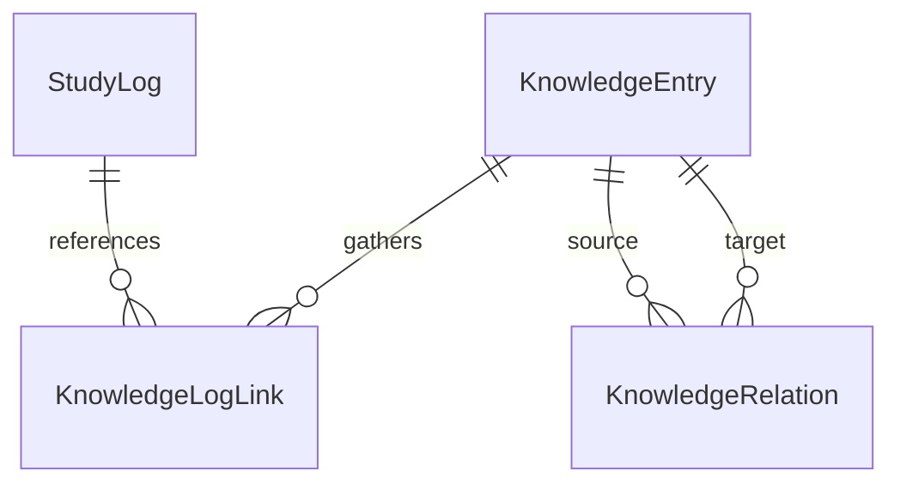

# 架构设计

## 总体架构

本项目采用经典的React单页应用架构，数据流采用单向数据流模式。

```
┌─────────────────────────────────────────┐
│           User Interface                │
│  (React Components + Tailwind CSS)      │
└──────────────┬──────────────────────────┘
               │
               ↓
┌─────────────────────────────────────────┐
│        State Management                 │
│           (Zustand)                     │
└──────────────┬──────────────────────────┘
               │
               ↓
┌─────────────────────────────────────────┐
│      Data Persistence Layer             │
│     LocalStorage + IndexedDB            │
└─────────────────────────────────────────┘
```

## 核心模块

### 页面组织

App 通过轻量 Hash 导航切换 `#today`、`#path`、`#history`、`#knowledge`、`#data` 五个入口，无新增路由依赖。各面板维持挂载、用原生 `hidden` 隐藏，避免切换时卸载番茄钟的计时 effect、丢失导入预览或编辑草稿。入口变化返回页顶；浏览器 hashchange 处理前后退及直接地址。`workspaceStore` 只保存临时导航选择，支持 `#history/YYYY-MM-DD` 与 `#knowledge/词条ID`；日期选择同时决定对应日历月份，不改变今日计时日志。

桌面今日页为番茄钟/笔记分栏，历史页为日历笔记/统计打卡分栏；窄屏纵向排列。顶部导航固定，其他入口显示精简计时状态与返回链接。长图文仍在自己的阅读区域中滚动，不再推动其他功能模块远离入口。

今日编辑区通过统一标签间距和共享高度规则对齐两框，两侧内容各自滚动。历史长文默认显示 320px 预览，通过 ResizeObserver 判断实际正文高度（包括图片加载后的变化）；短文不显示展开按钮。展开状态在切换功能入口时保留，切换记录或结束编辑后重新进入预览；编辑操作不受正文折叠影响。

### 1. 番茄钟模块（Pomodoro）

**职责**：
- 计时控制（开始、暂停、重置）
- 学习/休息模式切换
- 时间提醒

**数据结构**：
```typescript
interface PomodoroState {
  isRunning: boolean;
  timeLeft: number; // 秒
  mode: 'study' | 'break';
  studyDuration: number; // 默认25分钟
  breakDuration: number; // 默认5分钟
}
```

### 2. 学习记录模块（Study Log）

图文导入保持一天一条日志，按日期追加正文。今日与历史使用共享的正文编辑区和独立草稿，按记录 ID 保存，并检查正文是否已从另一入口更新。时长始终写入本地日历日期对应的今日日志。编辑时计时器保持挂载，页头提供计时状态。

`MarkdownContent` 统一处理今日、历史和导入预览的 Markdown。解析本地图片引用后替换为稳定的 `learning-image:<id>` 引用；图片 Blob 存入 IndexedDB 的 `learning-assistant-assets/images`，渲染时生成并在卸载时释放临时 URL。PNG/JPEG/GIF/WebP 按文件头检查；缺失或歧义图片须在保存前解决。其余本地文档链接仅保留来源提示，网络来源链接继续可用。

**职责**：
- 记录每日学习内容
- 支持Markdown格式
- 计算学习时长
- 连续学习天数统计

**数据结构**：
```typescript
interface StudyLog {
  id: string;
  date: string; // ISO格式日期
  duration: number; // 分钟
  content: string; // Markdown内容
  tags: string[]; // 标签（如"Unity", "C#", "算法"）
  knowledgePoints: string[]; // 学到的知识点
}

interface StreakState {
  currentStreak: number; // 当前连续天数
  longestStreak: number; // 最长连续天数
  lastStudyDate: string;
}
```

### 3. 技能树模块（Skill Tree）

**职责**：
- 展示学习路径
- 记录完成状态
- 解锁新技能

**数据结构**：
```typescript
interface SkillNode {
  id: string;
  name: string;
  description: string;
  category: 'Unity' | 'C#' | '算法' | '图形学' | '其他';
  status: 'locked' | 'available' | 'completed';
  prerequisites: string[]; // 前置技能ID
  estimatedTime: number; // 预计学习时长（小时）
}

interface SkillTree {
  nodes: SkillNode[];
  completedCount: number;
}
```

**实现约定**：预设路径定义与 UI 分离，持久化数据保存 `completedIds`。参考路径通过原有节点 ID 显示完成标记及任务，前置节点在界面中作为参考主题展示。

### 3.1 当前学习目标（Current Goal）

**职责**：保存用户当前聚焦的已解锁技能节点，为番茄钟与日志提供轻量的学习上下文。

**边界**：当前目标只会在番茄钟完成时作为标签写入当天学习日志；不会自动将学习时长等同于技能掌握，也不会自动完成技能节点。未来 AI 总结可在此上下文上补充内容提炼和归类。

### 3.2 自定义任务（Task）

**职责**：把较粗粒度的技能节点拆成近期可执行的任务。任务必须关联一个技能节点，包含标题、可选说明和完成状态；未完成任务可成为当前学习目标。

**边界**：任务完成不会自动完成父技能节点；任务不承担复杂依赖、截止日期、子任务或排序功能。任务数据独立存储在 `learning-assistant:tasks`，当前目标以 `{ type, id, label }` 保存，并兼容旧的技能目标数据。

**呈现策略**：当前版本直接在技能节点下管理任务，并把已完成任务折叠，优先展示待完成事项。当实际任务数量使节点卡片过长时，再演进为按需展开任务区和添加表单；这是一项体验扩展，不影响任务数据模型。

### 4. 统计模块（Statistics）

**职责**：
- 计算学习数据
- 生成图表数据

**指标**：
- 今日学习时长
- 本周学习时长
- 本月学习时长
- 总学习时长
- 连续学习天数

### 5. 知识词条（Knowledge）

**实体边界**：日志记录某天的学习情境；词条记录持续演进的理解；标签是分类文字；技能节点与任务服务于学习行动。词条不自动代表掌握，也不自动绑定技能节点。



`KnowledgeData` 单独以版本 1 持久化，包含三个数组：

- `entries`：稳定 ID、名称、别名数组、单层分类字符串、Markdown 正文和创建/更新时间。只要求名称，未分类用空字符串。
- `logLinks`：ID、词条 ID、日志 ID 与可选说明，按词条/日志对去重。保存历史情境，改名后关系保持。
- `relations`：ID、sourceId、targetId。当前语义仅为无方向“相关”，对双方显示，按排序后的 ID 对去重，禁止自关联。

`knowledgeStore` 负责 CRUD 与关系操作；每次先检查引用、名称和别名唯一性（忽略大小写、首尾空格和全半角差异），再持久化，成功后才更新内存状态。删除词条会同时移除它的日志链接及相关关系；解除链接不会删除词条或日志。读取失败保留原数据并禁止编辑。

`KnowledgeLinks` 复用于今日和历史日志，支持选择已有词条、新建并关联、关联说明及手动升级旧知识点；`KnowledgeBase` 提供目录、名称/别名检索、编辑器、原记录回链与相关词条。旧 `knowledgePoints: string[]` 不迁移、不覆盖，仍能独立使用。

本版不增加依赖，不实现关系类型、嵌套目录、自动提炼或图谱。稳定实体 ID 与独立关系数组为以后扩展保留边界；图片复用统一渲染器，词条内直接选择/粘贴图片后续评估。

### 6. 成长记录

`#path` 展示成长记录和可展开的参考路径。预设成果定义在 `growthPresets.ts` 中。首次保存实践时，使用预设 ID 或新生成的自定义 ID 建立成果，保存名称、领域和实践列表。后续实践追加到同一成果，并各自保存日期、说明、日志 ID 与词条 ID。

`growthStore` 将版本化成果数据写入 `learning-assistant:growth`，成功后更新界面。旧节点 ID、完成标记和任务继续由原有 store 管理。关联通过 ID 读取现有资料名称，词条改名会反映在卡片上。资料删除后，实践中的链接会提示不可用，编辑时可取消关联。

### 7. 项目代码

项目元数据、代码版本和关联保存在 `learning-assistant-assets` 的 `project-code` 对象仓库。数据库升级时沿用原图片仓库。每个版本有独立 ID，记录项目内路径、保存时间、说明、可选脚本文本及可选 GitHub 固定链接。脚本来源至少有一项。GitHub 链接固定到完整提交 ID 和文件路径，允许行号片段。

目录快照是项目的可选字段。浏览器返回用户所选文件夹下的文件相对路径，目录树由路径前缀构建。快照保存最新一次路径清单和对应的职责说明。勾选的 UTF-8 脚本先全部读完并通过校验，再用既有 IndexedDB 事务一并保存项目和代码版本。与同一路径最新的本地版本内容一致时复用该版本。更新快照保留原代码版本和关联。目录字段随 v5 备份导出和恢复，缺少该字段的旧项目仍可读取。[File and Directory Entries API](https://wicg.github.io/entries-api/#html-forms)

从日志创建版本与关联在同一次写入中完成，日志对代码的引用保存在项目代码库。实践和词条的编辑将所选代码版本 ID 与其他草稿内容一起写入。缺少新选择字段时读取旧版代码关联，明确保存空选择可解除旧关联。版本页和备份摘要按有效关联显示。若资料已删除，引用处会标注不可用。

再次保存脚本产生新版本。版本补录来源时复用已有 ID 与正文。

`#code` 是从成长记录打开的项目视图，`#code/版本ID` 直达版本。`#path/成果ID/实践ID` 用于返回具体实践。代码以高亮文本显示，GitHub 来源由用户点击打开。

### 8. 统一检索

`ResourceSearch` 在导航中打开检索弹窗，读取日志、词条和项目代码的 store。检索与 `ReferenceChoices` 共用字段选择、关键词规范化和匹配逻辑。代码筛选可将已存快照正文加入匹配范围，检索索引在内存中派生。

结果链接在原资料的 Hash 地址中携带关键词和源码命中标记。阅读区根据该地址定位第一处可见高亮，支持刷新、前后退和在新标签页打开。Markdown 在语法着色后标注渲染文本，可跨语法着色的行内片段匹配。每段渲染文本最多标亮前 500 处匹配。关键词和高亮属于导航状态。

### 9. 关系视图

`#relations/类型/资料ID` 打开单份资料的直接关系图。关系来自现有日志与词条关联、词条间关联以及有效代码引用。画布使用 SVG 绘制连线，资料卡和标签为可键盘操作的链接与按钮。窄屏用纵向排布，每组最多六条连线。

标签和补充说明随原关联保存。日志与词条、词条间标注在知识数据中，日志与代码标注在代码引用中，词条与代码标注随词条所选版本保存。旧版词条代码引用首次编辑标注时使用已有版本选择。完整备份 v5 支持这些可选字段，旧备份缺少标注时使用“相关”。

`#network` 打开知识网络总览，`#network/词条ID` 预选指定词条。总览与单份资料的关系视图从同一组资料和关联派生节点与连线，并共用连线编辑表单。创建或移除关联时写回已有的词条和代码关联数据。布局按词条分类和资料类型组织，按画布宽高比排列分组。图层过滤后，保留与可见词条连通的日志和代码版本。一跳、两跳范围从所选节点沿可见连线计算。单条选中连线优先使用避开卡片的路径，密集的全网连线仍可能交错。

画布内的搜索按资料元数据匹配，定位时可显示当前隐藏的节点。连线草稿在画布内显示端点和预览线，关联和标注使用已有 store 在一次写入中保存。全屏使用浏览器的全屏接口。画布使用中心坐标和缩放倍数控制视野，Ctrl 滚轮以指针位置为缩放基准。节点拖动调整本次画布的节点偏移，显示边界与连线随位置更新。“适应窗口”按当前布局计算视野，重置节点位置可恢复自动布局。画布内新建词条复用词条编辑器。

首次打开知识网络后，切到其他资料页时隐藏画布并保留组件状态。隐藏期间忽略零尺寸测量。带词条 ID 的历史条目记录是否已定位，浏览器后退或前进复用该条目时恢复画布，新打开的词条回链可再次定位。视图状态存在当前页面会话中。

模块可见性按现有词条分类集合和图层开关过滤资料。隐藏分类时先移除该组词条及相连的边，再从可见词条计算可达的日志和代码版本。侧栏将直接跨分类连线按模块对归组，同一资料被至少两个可见模块的词条直接关联时计入共同资料。“只看跨模块关联”保留可见词条、这些资料和对应连线。工具栏和画布右键修改同一份可见性状态。

手动布局叠加节点偏移和模块偏移。模块键由节点类型和词条分类组成，背景和成员共享同一偏移，恢复显示时沿用它。日志与代码分组的右键隐藏和工具栏写入同一组图层开关。框选使用当前平移和缩放后的位置判定。拖动在画布上预览，松开时将整次位移写为一步操作。

多选范围在模块、图层和单节点聚焦筛选之后计算。直接模式保留所选节点及其直接连线。中间节点开关从当前范围找出没有直连的所选节点对的共同邻居，只保留构成这些两跳路径的连线。所选视图单独维护平移与缩放，退出后恢复先前视角。

空白处的普通左键单击在松开时退出连线详情或多选视图中的节点详情，保留节点集合、筛选与视角。平移和 Shift 框选沿用拖动距离判定。全屏编辑弹窗打开期间，在支持的浏览器中用 Keyboard Lock API 将 Esc 交给弹窗。按下 Esc 时取消原生关闭，松开同一次按键后再关闭弹窗并释放键锁。退出全屏或离开画布也会清理键锁和监听器。[Chromium 全屏按键处理](https://github.com/chromium/chromium/blob/main/chrome/browser/ui/exclusive_access/exclusive_access_manager.cc#L178)

词条编辑复用既有表单，分类操作在知识词条 store 中一次保存，沿用既有分类字段和关联。重命名为已有分类时合并成员。画布在同一标签页内保留最多 50 步撤销历史。数据撤销按受影响的词条及关联恢复，校验当前值后再写入，以保留期间的其他修改。文本编辑使用浏览器的输入撤销。

`?workspace=knowledge-demo` 在挂载应用前用现有备份恢复流程加载演示数据。演示的 LocalStorage 键使用 `learning-assistant-demo:` 前缀，图片与项目代码使用 `learning-assistant-demo-assets` IndexedDB。首次打开或显式恢复演示时加载内置数据，之后的修改保存在演示工作区。个人工作区沿用原有存储，页面内跳转保留当前工作区。

演示初始化标记区分样例版本。旧版演示在原词条和来源仍存在时补齐共同日志、共同代码的示例关系。补齐只更新演示词条数据，写入版本标记后续沿用已有演示内容。

## 数据持久化

### LocalStorage结构

```typescript
// 存储键名
const STORAGE_KEYS = {
  STUDY_LOGS: 'learning-assistant:study-logs',
  KNOWLEDGE: 'learning-assistant:knowledge',
  SKILL_TREE: 'learning-assistant:skill-tree',
  CURRENT_GOAL: 'learning-assistant:current-goal',
  TASKS: 'learning-assistant:tasks',
  STREAK: 'learning-assistant:streak',
  SETTINGS: 'learning-assistant:settings',
} as const;
```

### 数据迁移策略

当需要改变数据结构时：
1. 添加版本号字段
2. 编写迁移函数
3. 应用启动时检查版本并迁移

当前还兼容读取早期开发工具生成的 `learning-assistant:log:YYYY-MM-DD` 记录：首次加载时仅将缺失日期复制到正式学习日志，不覆盖或删除原数据。

```typescript
interface StorageData {
  version: number;
  data: any;
}
```

### 数据备份与恢复

备份 v5 在图文、词条和成长记录之外保存项目代码及关联。恢复按版本读取内容并整体替换本地数据。v1 至 v4 可恢复各版本包含的数据，缺少的数据类别以空集合初始化。界面在确认前列出旧版备份缺少的数据类别。

导入先校验记录字段、图片引用、代码链接格式、项目与版本关联，再展示摘要。用户确认后才替换数据并刷新。恢复先记录原有 LocalStorage 数据，再在同一个 IndexedDB 事务内替换图片和项目代码。事务失败时两类资料均回退，LocalStorage 同时恢复。清除旧版按日期调试键，避免刷新时迁移回已被替换的记录。

## 状态管理（Zustand）

采用分片管理，每个模块独立store：

```typescript
// 番茄钟store
const usePomodoroStore = create<PomodoroState>((set) => ({...}));

// 学习日志store
const useStudyLogStore = create<StudyLogState>((set) => ({...}));

// 技能树store
const useSkillTreeStore = create<SkillTreeState>((set) => ({...}));
```

## 组件设计原则

1. **单一职责**：每个组件只负责一个功能
2. **可复用性**：通用组件放在`components/common/`
3. **TypeScript严格模式**：所有props和state都有类型定义
4. **可测试性**：逻辑与UI分离，便于单元测试

## 未来扩展点

1. **AI推荐系统**：
   - 接入GPT API
   - 根据学习日志分析知识点
   - 推荐下一步学习内容

2. **云端同步**：
   - 后端API设计
   - 数据加密
   - 冲突解决策略

3. **社交功能**：
   - 学习打卡分享
   - 好友互相督促
