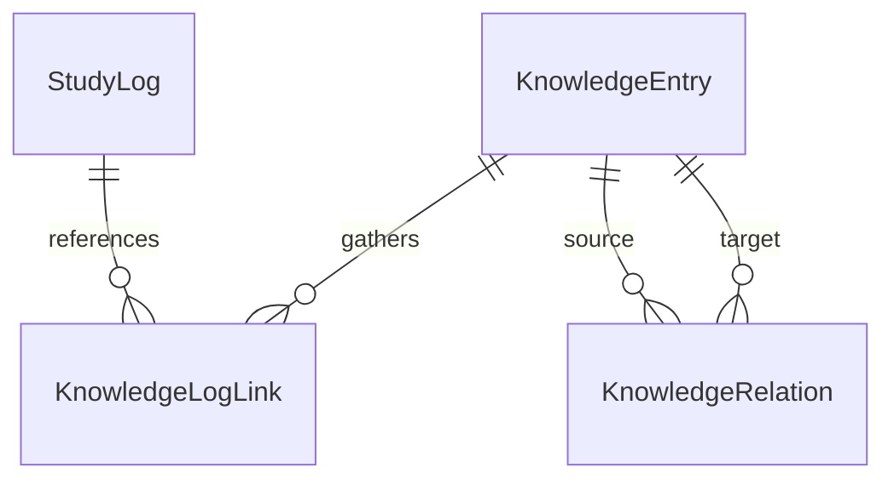

# 架构设计

## 总体架构

本项目采用经典的React单页应用架构，数据流采用单向数据流模式。

```
┌─────────────────────────────────────────┐
│           User Interface                │
│  (React Components + Tailwind CSS)      │
└──────────────┬──────────────────────────┘
               │
               ↓
┌─────────────────────────────────────────┐
│        State Management                 │
│           (Zustand)                     │
└──────────────┬──────────────────────────┘
               │
               ↓
┌─────────────────────────────────────────┐
│      Data Persistence Layer             │
│     LocalStorage + IndexedDB            │
└─────────────────────────────────────────┘
```

## 核心模块

### 页面组织

App 通过轻量 Hash 导航切换 `#today`、`#path`、`#history`、`#knowledge`、`#data` 五个入口，无新增路由依赖。各面板维持挂载、用原生 `hidden` 隐藏，避免切换时卸载番茄钟的计时 effect、丢失导入预览或编辑草稿。入口变化返回页顶；浏览器 hashchange 处理前后退及直接地址。`workspaceStore` 只保存临时导航选择，支持 `#history/YYYY-MM-DD` 与 `#knowledge/词条ID`；日期选择同时决定对应日历月份，不改变今日计时日志。

桌面今日页为番茄钟/笔记分栏，历史页为日历笔记/统计打卡分栏；窄屏纵向排列。顶部导航固定，其他入口显示精简计时状态与返回链接。长图文仍在自己的阅读区域中滚动，不再推动其他功能模块远离入口。

今日编辑区通过统一标签间距和共享高度规则对齐两框，两侧内容各自滚动。历史长文默认显示 320px 预览，通过 ResizeObserver 判断实际正文高度（包括图片加载后的变化）；短文不显示展开按钮。展开状态在切换功能入口时保留，切换记录或结束编辑后重新进入预览；编辑操作不受正文折叠影响。

### 1. 番茄钟模块（Pomodoro）

**职责**：
- 计时控制（开始、暂停、重置）
- 学习/休息模式切换
- 时间提醒

**数据结构**：
```typescript
interface PomodoroState {
  isRunning: boolean;
  timeLeft: number; // 秒
  mode: 'study' | 'break';
  studyDuration: number; // 默认25分钟
  breakDuration: number; // 默认5分钟
}
```

### 2. 学习记录模块（Study Log）

图文导入保持原有“一天一条日志”模型，不改变旧记录字段。导入选择学习日期并追加正文；历史正文编辑按记录 ID 保存，不切换当前计时目标。时长始终写入本地日历日期对应的今日日志，导入或补充不触发打卡。

`MarkdownContent` 统一处理今日、历史和导入预览的 Markdown。解析本地图片引用后替换为稳定的 `learning-image:<id>` 引用；图片 Blob 存入 IndexedDB 的 `learning-assistant-assets/images`，渲染时生成并在卸载时释放临时 URL。PNG/JPEG/GIF/WebP 按文件头检查；缺失或歧义图片须在保存前解决。其余本地文档链接仅保留来源提示，网络来源链接继续可用。

**职责**：
- 记录每日学习内容
- 支持Markdown格式
- 计算学习时长
- 连续学习天数统计

**数据结构**：
```typescript
interface StudyLog {
  id: string;
  date: string; // ISO格式日期
  duration: number; // 分钟
  content: string; // Markdown内容
  tags: string[]; // 标签（如"Unity", "C#", "算法"）
  knowledgePoints: string[]; // 学到的知识点
}

interface StreakState {
  currentStreak: number; // 当前连续天数
  longestStreak: number; // 最长连续天数
  lastStudyDate: string;
}
```

### 3. 技能树模块（Skill Tree）

**职责**：
- 展示学习路径
- 记录完成状态
- 解锁新技能

**数据结构**：
```typescript
interface SkillNode {
  id: string;
  name: string;
  description: string;
  category: 'Unity' | 'C#' | '算法' | '图形学' | '其他';
  status: 'locked' | 'available' | 'completed';
  prerequisites: string[]; // 前置技能ID
  estimatedTime: number; // 预计学习时长（小时）
}

interface SkillTree {
  nodes: SkillNode[];
  completedCount: number;
}
```

**实现约定**：预设路径定义与 UI 分离，持久化数据保存 `completedIds`。参考路径通过原有节点 ID 显示完成标记及任务，前置节点在界面中作为参考主题展示。

### 3.1 当前学习目标（Current Goal）

**职责**：保存用户当前聚焦的已解锁技能节点，为番茄钟与日志提供轻量的学习上下文。

**边界**：当前目标只会在番茄钟完成时作为标签写入当天学习日志；不会自动将学习时长等同于技能掌握，也不会自动完成技能节点。未来 AI 总结可在此上下文上补充内容提炼和归类。

### 3.2 自定义任务（Task）

**职责**：把较粗粒度的技能节点拆成近期可执行的任务。任务必须关联一个技能节点，包含标题、可选说明和完成状态；未完成任务可成为当前学习目标。

**边界**：任务完成不会自动完成父技能节点；任务不承担复杂依赖、截止日期、子任务或排序功能。任务数据独立存储在 `learning-assistant:tasks`，当前目标以 `{ type, id, label }` 保存，并兼容旧的技能目标数据。

**呈现策略**：当前版本直接在技能节点下管理任务，并把已完成任务折叠，优先展示待完成事项。当实际任务数量使节点卡片过长时，再演进为按需展开任务区和添加表单；这是一项体验扩展，不影响任务数据模型。

### 4. 统计模块（Statistics）

**职责**：
- 计算学习数据
- 生成图表数据

**指标**：
- 今日学习时长
- 本周学习时长
- 本月学习时长
- 总学习时长
- 连续学习天数

### 5. 知识词条（Knowledge）

**实体边界**：日志记录某天的学习情境；词条记录持续演进的理解；标签是分类文字；技能节点与任务服务于学习行动。词条不自动代表掌握，也不自动绑定技能节点。



`KnowledgeData` 单独以版本 1 持久化，包含三个数组：

- `entries`：稳定 ID、名称、别名数组、单层分类字符串、Markdown 正文和创建/更新时间。只要求名称，未分类用空字符串。
- `logLinks`：ID、词条 ID、日志 ID 与可选说明，按词条/日志对去重。保存历史情境，改名后关系保持。
- `relations`：ID、sourceId、targetId。当前语义仅为无方向“相关”，对双方显示，按排序后的 ID 对去重，禁止自关联。

`knowledgeStore` 负责 CRUD 与关系操作；每次先检查引用、名称和别名唯一性（忽略大小写、首尾空格和全半角差异），再持久化，成功后才更新内存状态。删除词条会同时移除它的日志链接及相关关系；解除链接不会删除词条或日志。读取失败保留原数据并禁止编辑。

`KnowledgeLinks` 复用于今日和历史日志，支持选择已有词条、新建并关联、关联说明及手动升级旧知识点；`KnowledgeBase` 提供目录、名称/别名检索、编辑器、原记录回链与相关词条。旧 `knowledgePoints: string[]` 不迁移、不覆盖，仍能独立使用。

本版不增加依赖，不实现关系类型、嵌套目录、自动提炼或图谱。稳定实体 ID 与独立关系数组为以后扩展保留边界；图片复用统一渲染器，词条内直接选择/粘贴图片后续评估。

### 6. 成长记录

`#path` 展示成长记录和可展开的参考路径。预设成果定义在 `growthPresets.ts` 中。首次保存实践时，使用预设 ID 或新生成的自定义 ID 建立成果，保存名称、领域和实践列表。后续实践追加到同一成果，并各自保存日期、说明、日志 ID 与词条 ID。

`growthStore` 将版本化成果数据写入 `learning-assistant:growth`，成功后更新界面。旧节点 ID、完成标记和任务继续由原有 store 管理。关联通过 ID 读取现有资料名称，词条改名会反映在卡片上。资料删除后，实践中的链接会提示不可用，编辑时可取消关联。

## 数据持久化

### LocalStorage结构

```typescript
// 存储键名
const STORAGE_KEYS = {
  STUDY_LOGS: 'learning-assistant:study-logs',
  KNOWLEDGE: 'learning-assistant:knowledge',
  SKILL_TREE: 'learning-assistant:skill-tree',
  CURRENT_GOAL: 'learning-assistant:current-goal',
  TASKS: 'learning-assistant:tasks',
  STREAK: 'learning-assistant:streak',
  SETTINGS: 'learning-assistant:settings',
} as const;
```

### 数据迁移策略

当需要改变数据结构时：
1. 添加版本号字段
2. 编写迁移函数
3. 应用启动时检查版本并迁移

当前还兼容读取早期开发工具生成的 `learning-assistant:log:YYYY-MM-DD` 记录：首次加载时仅将缺失日期复制到正式学习日志，不覆盖或删除原数据。

```typescript
interface StorageData {
  version: number;
  data: any;
}
```

### 数据备份与恢复

备份 v4 在图文、词条及原有应用数据之外保存成长记录。恢复按版本读取内容并整体替换本地数据。v1 至 v3 可恢复各版本包含的数据，成长记录以空集合初始化。界面在确认前列出旧版备份缺少的数据类别。

导入先校验记录字段、图片内容编码、日志和词条中的图片引用，以及词条/日志/关系的引用完整性，再展示摘要；用户确认后才替换数据并刷新。恢复先准备所有数据并记录原文字快照（包含知识数据），图片在单次 IDB 事务内替换；失败时事务保留原图并回退文字数据。清除旧版按日期调试键，避免刷新时迁移回已被替换的记录。

## 状态管理（Zustand）

采用分片管理，每个模块独立store：

```typescript
// 番茄钟store
const usePomodoroStore = create<PomodoroState>((set) => ({...}));

// 学习日志store
const useStudyLogStore = create<StudyLogState>((set) => ({...}));

// 技能树store
const useSkillTreeStore = create<SkillTreeState>((set) => ({...}));
```

## 组件设计原则

1. **单一职责**：每个组件只负责一个功能
2. **可复用性**：通用组件放在`components/common/`
3. **TypeScript严格模式**：所有props和state都有类型定义
4. **可测试性**：逻辑与UI分离，便于单元测试

## 未来扩展点

1. **AI推荐系统**：
   - 接入GPT API
   - 根据学习日志分析知识点
   - 推荐下一步学习内容

2. **云端同步**：
   - 后端API设计
   - 数据加密
   - 冲突解决策略

3. **社交功能**：
   - 学习打卡分享
   - 好友互相督促
