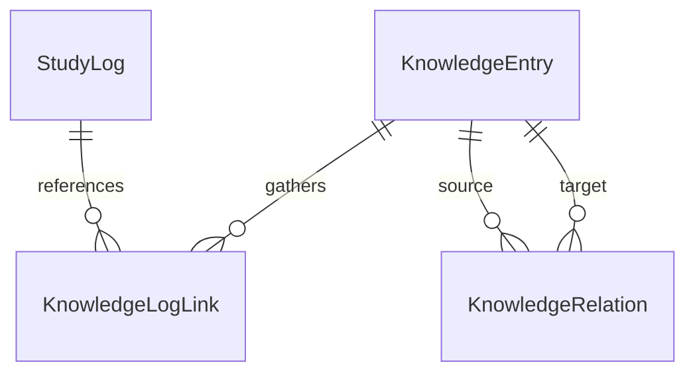

# 架构设计

## 总体架构

这是一个本地运行的 React 单页应用。功能组件调用 Zustand store 处理状态和写入，学习资料保存在浏览器。学习智能体通过本机 Vite 中间件调用 DeepSeek，模型结果先成为可核对的建议，由使用者确认后进入原有保存流程。

| 目录 | 职责 |
| --- | --- |
| [`src/App.tsx`](../src/App.tsx) 与 [`src/main.tsx`](../src/main.tsx) | 应用入口、工作区初始化、导航和页面装配 |
| [`src/components/`](../src/components) | 功能页面与交互。`common` 提供共享编辑器、筛选和输入组件 |
| [`src/store/`](../src/store) | 学习资料与页面状态、跨资料写入和回收站操作 |
| [`src/types/`](../src/types) 与 [`src/utils/`](../src/utils) | 资料类型、客户端与服务端共用的请求契约，以及校验、检索、Markdown 和存储等逻辑 |
| [`src/data/`](../src/data) | 参考主题、练习和测试工作区样例 |
| [`server/logReview.ts`](../server/logReview.ts) | 学习智能体三个接口的 Vite 中间件 |
| [`tests/`](../tests) | Playwright 浏览器回归。各功能验收指南链接到对应的用例 |

## 核心模块

### 页面组织

App 使用 Hash 导航切换今日学习、成长记录、历史回顾、知识词条、知识网络、数据管理和项目代码。需要保留的面板维持挂载，用原生 `hidden` 管理可见性。浏览器的 `hashchange` 支持前后退及直接地址。`workspaceStore` 保存临时导航选择，例如 `#history/YYYY-MM-DD` 对应的日历月份和 `#knowledge/词条ID` 对应的词条。

今日、历史日志和词条共用 `MarkdownFields` 和 `MarkdownInsertOptions`。各表单持有独立草稿和新图片。`saveWithImages` 先写入仍被正文引用的图片，再写入记录。记录写入失败时清理本次写入的图片。导航和编辑交互见 [前端交互约定](./FRONTEND_GUIDE.md) 与 [使用指南](./USER_GUIDE.md)。

### 1. 番茄钟模块（Pomodoro）

`pomodoroStore` 管理学习和休息计时。应用切页时保留计时器，完成学习时把时长和已选学习目标标签写入当天日志，并更新打卡记录。[计时状态与动作](../src/store/pomodoroStore.ts)

### 2. 学习记录模块（Study Log）

图文导入保持一天一条日志，按日期追加正文。今日与历史使用共享的正文编辑区和独立草稿，按记录 ID 保存，并检查正文是否已从另一入口更新。时长始终写入本地日历日期对应的今日日志。编辑时计时器保持挂载，页头提供计时状态。

`MarkdownContent` 统一渲染日志、词条和导入预览。导入时将本地图片替换为稳定的 `learning-image:<id>` 引用。图片 Blob 写入 IndexedDB，渲染时使用临时 URL，并在卸载时释放。图片类型按文件头校验，缺失或歧义图片须在保存前解决。日志的 `taskIds` 保存任务引用，回收站中的日志由 `deletedAt` 区分。[学习日志与打卡类型](../src/types/index.ts) · [图文验收](./GRAPHIC_NOTES_ACCEPTANCE.md)

### 3. 技能树模块（Skill Tree）

参考主题的预设路径定义与界面分离，`skillTreeStore` 持久化完成 ID、自定义主题和预设修改。参考路径通过原有节点 ID 显示完成标记及任务，前置节点在界面中作为参考主题展示。[主题持久化结构](../src/utils/skillPathStorage.ts)

### 3.1 当前学习目标（Current Goal）

当前学习目标可指向主题、任务、历史实践或成长卡片。`currentGoalStore` 读入旧的技能目标，并用 `{ type, id, label }` 保存当前目标。番茄钟完成学习时将目标名称写为日志标签。主题和任务进度由各自的操作更新。[目标存储](../src/store/currentGoalStore.ts)

### 3.2 自定义任务（Task）

每项任务通过父节点 ID 归属一个主题，具有独立的完成状态。未完成任务可被选为当前学习目标。日志通过任务 ID 建立关联，删除任务时清理相关日志引用和当前目标。跨键写入由 `writeStorageItems` 回滚部分失败。[任务存储](../src/store/taskStore.ts) · [任务关联验收](./TEST_WORKSPACE_ACCEPTANCE.md#任务关联与界面提示)

### 4. 统计模块（Statistics）

时长汇总和图表数据从学习日志派生，打卡记录由 `streakStore` 维护。[打卡状态](../src/store/streakStore.ts)

### 5. 知识词条（Knowledge）

**实体边界**：日志记录某天的学习情境；词条记录持续演进的理解；标签是分类文字；技能节点与任务服务于学习行动。词条不自动代表掌握，也不自动绑定技能节点。

知识词条以独立的存储版本 1 保存，主体包含三个数组，回收站保留被移出的词条及其相关关联。结构见 [`StoredKnowledgeData`](../src/types/index.ts)。

- `entries`：稳定 ID、名称、别名数组、单层分类字符串、Markdown 正文和创建/更新时间。只要求名称，未分类用空字符串。
- `logLinks`：ID、词条 ID、日志 ID 与可选说明，按词条/日志对去重。保存历史情境，改名后关系保持。
- `relations`：ID、sourceId、targetId。当前语义仅为无方向“相关”，对双方显示，按排序后的 ID 对去重，禁止自关联。

`knowledgeStore` 负责 CRUD 与关系操作；每次先检查引用、名称和别名唯一性（忽略大小写、首尾空格和全半角差异），再持久化，成功后才更新内存状态。删除词条会同时移除它的日志链接及相关关系；解除链接不会删除词条或日志。读取失败保留原数据并禁止编辑。

`KnowledgeLinks` 复用于今日和历史日志，支持选择已有词条、新建并关联、关联说明及手动升级旧知识点；`KnowledgeBase` 提供目录、名称/别名检索、编辑器、原记录回链与相关词条。旧 `knowledgePoints: string[]` 不迁移、不覆盖，仍能独立使用。

词条详情和知识网络内的编辑弹窗共用 `KnowledgeEditor`。词条可在正文插入图片、表格、分隔线、词条链接和代码版本链接。正文链接随 Markdown 保存，关联关系由各自的资料选择流程管理。原有的日志引用可显示编号和返回对应记录。

### 6. 成长记录

侧栏提供「成长记录」及参考路径、项目代码。卡片页通过 `#path` 和 `#path/try` 切换完成状态。已保存实践的预设从待尝试中移除，成果和实践深链接分别打开对应详情和指定实践。参考路径仅展示所选主题。成长页入口、智能体工具栏及问答共用智能体窗口中持续挂载的推荐面板。首次保存实践时使用预设 ID 或新的自定义 ID 建立成果，后续实践追加到同一成果，并各自保存日期、说明及关联资料 ID。

卡片菜单写入 `growth-card` 类型的当前目标，沿用番茄钟和备份流程。询问智能体复用自由问答，用户发送后才附带卡片标题、领域及最多 1200 字符的说明。

成长数据包含收藏练习和主题卡组。读取旧数据时补齐空数组。收藏保存名称、领域、行动、完成条件及来源 ID。卡组用稳定卡片 ID 保存成员，卡片状态由是否已有实践决定。收藏、实践与卡组共用同一份数据写入和备份校验。看板及全局检索通过 `group` 与可选的 `card` 参数打开同一弹窗，带组名的详情返回链接保留原看板。

自建与编辑过的待尝试卡片沿用练习结构。编辑内置练习时用原 ID 保存覆盖内容，移出内置练习时记录隐藏 ID，恢复后仍沿用原卡片和卡组。待尝试详情使用 `#path/try/<id>`。成果的卡片说明与每次实践备注分别保存。

练习推荐按领域、卡组名称和用户偏好匹配本地日志、词条及代码版本资料。`/api/growth-suggestions` 复用本机 DeepSeek 服务，根据资料摘要生成候选、完成条件和来源编号。客户端校验编号并转换为原资料链接。推荐保留于页面会话，收藏或保存实践时写入成长数据。组内发起的推荐以当前卡组为保存目标。

`growthStore` 将版本化成果数据写入 `learning-assistant:growth`，成功后更新界面。旧节点 ID、完成标记和任务继续由原有 store 管理。关联通过 ID 读取现有资料名称，词条改名会反映在卡片上。资料删除后，实践中的链接会提示不可用，编辑时可取消关联。

### 7. 项目代码

项目元数据、代码版本和关联保存在 `learning-assistant-assets` 的 `project-code` 对象仓库。数据库升级时沿用原图片仓库。每个版本有独立 ID，记录项目内路径、保存时间、说明、可选脚本文本及可选 GitHub 固定链接。脚本来源至少有一项。GitHub 链接固定到完整提交 ID 和文件路径，允许行号片段。

目录快照是项目的可选字段，保存项目相对路径和职责说明。勾选的 UTF-8 脚本先全部读完并通过校验，再用 IndexedDB 事务一并保存项目和代码版本。与同一路径最新版本内容一致时复用版本。刷新目录快照保留已有代码版本和关联，旧备份缺少目录字段时仍可恢复。[项目代码验收](./PROJECT_CODE_ACCEPTANCE.md#项目目录导入)

从日志创建版本与关联在同一次写入中完成，日志对代码的引用保存在项目代码库。实践和词条的编辑将所选代码版本 ID 与其他草稿内容一起写入。缺少新选择字段时读取旧版代码关联，明确保存空选择可解除旧关联。版本页和备份摘要按有效关联显示。若资料已删除，引用处会标注不可用。

再次保存脚本产生新版本。版本补录来源时复用已有 ID 与正文。

`#code` 是从成长记录打开的项目视图，`#code/版本ID` 直达版本。`#path/成果ID/实践ID` 用于返回具体实践。代码以高亮文本显示，GitHub 来源由用户点击打开。

### 8. 统一检索

`ResourceSearch` 在导航中打开检索弹窗，从日志、词条、项目代码和成长记录的 store 派生内存检索索引。范围包含实践卡片和卡组。检索与 `ReferenceChoices` 复用字段选择、关键词规范化和匹配逻辑。代码筛选可将已存快照正文加入匹配范围。[检索组件](../src/components/Search/ResourceSearch.tsx) · [匹配逻辑](../src/utils/resourceSearch.ts)

结果链接在原资料的 Hash 地址中携带关键词和源码命中标记。阅读区根据该地址定位第一处可见高亮，支持刷新、前后退和在新标签页打开。Markdown 在语法着色后标注渲染文本，可跨语法着色的行内片段匹配。每段渲染文本最多标亮前 500 处匹配。关键词和高亮属于导航状态。

### 9. 关系视图

`#relations/类型/资料ID` 打开单份资料的直接关系图，`#network` 打开知识网络总览。两者从词条、日志和代码的同一组资料及关联派生节点与连线，共用连线编辑表单。更改关系时写回原 store，标签和补充说明随原关联保存。旧备份缺少标注时显示「相关」。[关系读写](../src/store/networkRelations.ts)

知识网络按词条分类及资料类型分组。图层与分类筛选先决定可见节点，再据此计算连线、一跳和两跳范围。多选视图可以保留直接连线，或补入连接所选节点对的共同邻居。其平移和缩放与全网独立，退出时恢复先前视角。

画布首次打开后维持挂载，布局偏移、视野和筛选留在当前页面会话。带词条 ID 的历史条目记录定位状态，浏览器前后退时复用视角。拖动用临时偏移预览，松开后记为一步。数据撤销按受影响的词条和关联校验当前值再写入，以保留期间的其他编辑。画布内词条编辑复用 `KnowledgeEditor`。

全屏编辑弹窗在支持的浏览器使用 Keyboard Lock，将 Esc 交给弹窗并在按键释放后关闭。离开画布或退出全屏时清理键锁和监听器。布局操作与键盘行为见 [知识词条与网络验收](./KNOWLEDGE_ACCEPTANCE.md#8-知识网络总览)。

## 学习智能体与本机接口

浮动面板挂载在应用层。今日和历史编辑器各自持有整理草稿，并把对应视图渲染进面板。切页后草稿保留在原编辑器。自由问答和练习推荐使用页面会话状态，日期、词条和实践等资料由浏览器本地检索。窗口交互与引用范围可按 [学习智能体验收](./LOG_REVIEW_ACCEPTANCE.md) 核对。

日志整理先由模型提取查询词，再由浏览器检索词条及关系，连同有限的资料摘要生成建议。客户端核验原文引用和词条 ID，保存时仅应用确认采纳的建议。日志写入失败时回退此次知识库写入。练习推荐同样先筛选本地资料，客户端将返回的来源编号还原为原资料链接。

[`vite.config.ts`](../vite.config.ts) 从本机环境文件读取 DeepSeek 配置，向开发服务和构建预览注册中间件。三个接口只接受本机同源的 JSON `POST` 请求，单次请求体上限 256 KiB，共享一个并发槽，模型调用超时 45 秒。

| 接口 | 用途与契约定义 |
| --- | --- |
| `/api/log-review` | 提取查询词、生成整理建议和在对话中修改日志草稿。[整理契约](../src/types/logReview.ts) · [整理对话契约](../src/types/reviewConversation.ts) |
| `/api/assistant-chat` | 自由问答、引用资料、主题任务草稿和卡组分析。[问答契约](../src/types/assistantChat.ts) |
| `/api/growth-suggestions` | 根据本地资料摘要推荐练习并返回来源编号。[练习推荐契约](../src/types/growthSuggestions.ts) |

失败返回带 `error` 字段的 JSON。`400` 表示输入无效，`403` 表示来源或内容类型不符，`405` 表示方法不符，`413` 表示请求过大，`429` 表示已有请求在运行，`502` 表示上游调用或结果处理失败，`503` 表示缺少密钥。[中间件实现](../server/logReview.ts) · [本机配置](./SETUP.md#配置-deepseek)

## 数据持久化

### 工作区与存储边界

| 工作区 | LocalStorage 键前缀 | IndexedDB 库名 |
| --- | --- | --- |
| 个人 | `learning-assistant:` | `learning-assistant-assets` |
| 测试（`?workspace=knowledge-demo`） | `learning-assistant-demo:` | `learning-assistant-demo-assets` |

学习资料的键统一由 `STORAGE_KEYS` 生成，包括日志 `study-logs`、词条 `knowledge`、成长记录 `growth`、主题 `skill-tree`、任务 `tasks`、当前目标 `current-goal` 和打卡 `streak`。备份同时保留 `settings` 和 `pomodoro-today` 键的已有内容。旧的 `log:YYYY-MM-DD` 键按工作区读取，只把缺失的日期合入正式日志。浏览器界面偏好按各自的用途独立保存。[键定义](../src/utils/storage.ts) · [工作区标识](../src/utils/workspaceMode.ts)

两个工作区的 IndexedDB 都有 `images` 和 `project-code` 对象仓库。升级数据库时复用已有图片仓库。测试工作区在挂载应用前准备样例，首次初始化和显式重置使用备份恢复流程。已初始化的样例继续使用自己的本地数据。[资产数据库](../src/utils/assetDatabase.ts) · [样例初始化](../src/data/knowledgeDemo.ts)

### 数据备份与恢复

当前导出为 v9，导入器接受 v1 至 v9。旧版未包含的资料使用空集合，确认界面会提示缺少的资料类别。备份版本与各实体的独立存储版本分别维护。[读写实现](../src/utils/dataBackup.ts) · [备份界面](../src/components/DataManagement/DataBackup.tsx)

| 版本 | 读入范围与演进 |
| --- | --- |
| v1 | 基础日志、任务和可选的主题、当前目标、打卡及设置 |
| v2 | 加入图片附件 |
| v3 | 加入词条和关联 |
| v4 | 加入成长记录 |
| v5 | 加入项目代码 |
| v6 | 加入日志回收站 |
| v7、v8 | 导入器兼容两版。v8 导出纳入词条和代码的回收站，缺少这些字段时校验器补为空 |
| v9 | 导出随当前目标扩展支持成长卡片，保留旧目标类型。任务关联使用日志里的可选 `taskIds` |

恢复先校验字段、ID、图片引用和代码来源，然后显示摘要。用户确认后整体替换。写入前记录原 LocalStorage 值，图片和代码在同一 IndexedDB 事务中替换。事务失败时两类资产由事务回退，恢复流程重新写回原 LocalStorage 值。成功后刷新，并清除旧的按日期日志键以避免重新导入。备份验证入口见 [图文日志](./GRAPHIC_NOTES_ACCEPTANCE.md#3-图文备份与恢复推荐用独立浏览器验证恢复) 和 [项目代码](./PROJECT_CODE_ACCEPTANCE.md)。

后续功能与验证计划见 [待办事项](./TODO.md)。
